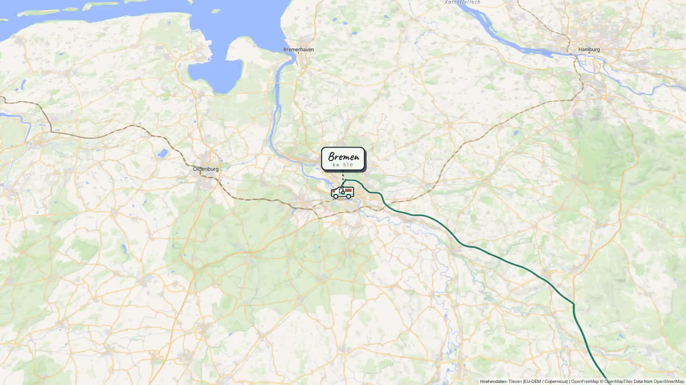
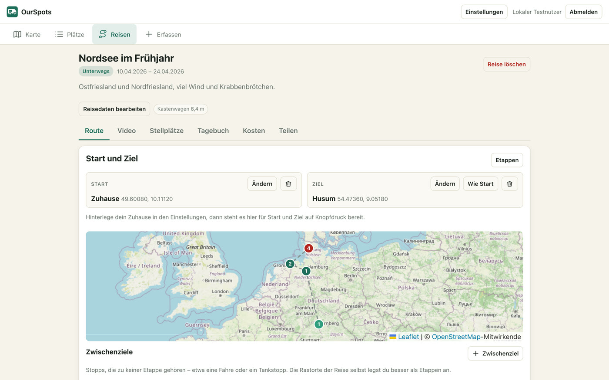
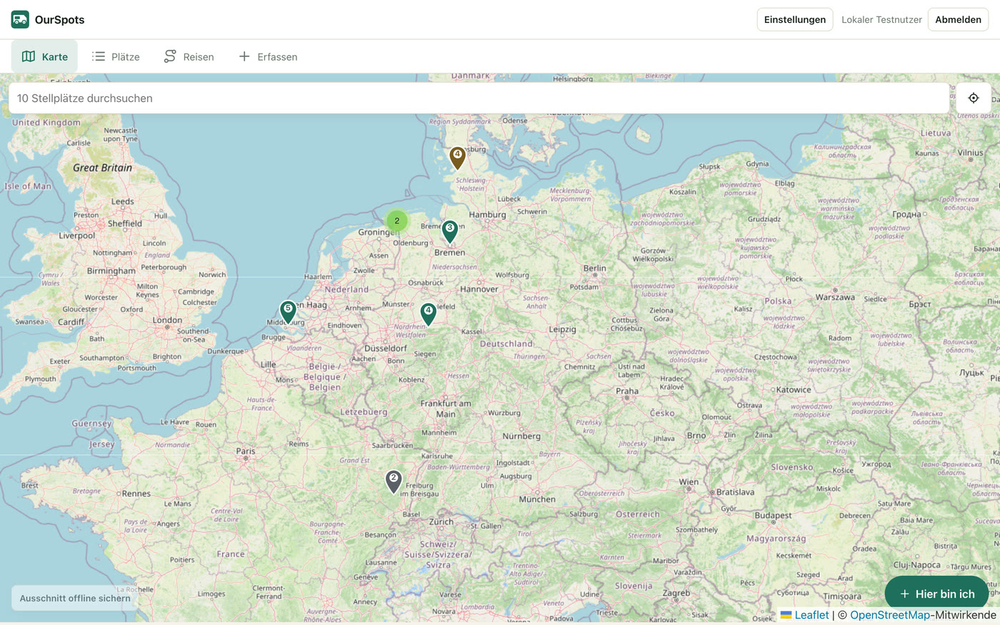
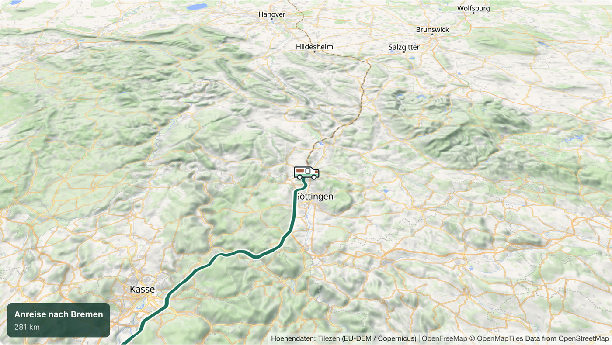
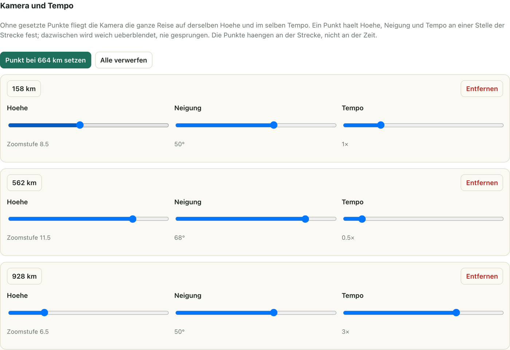
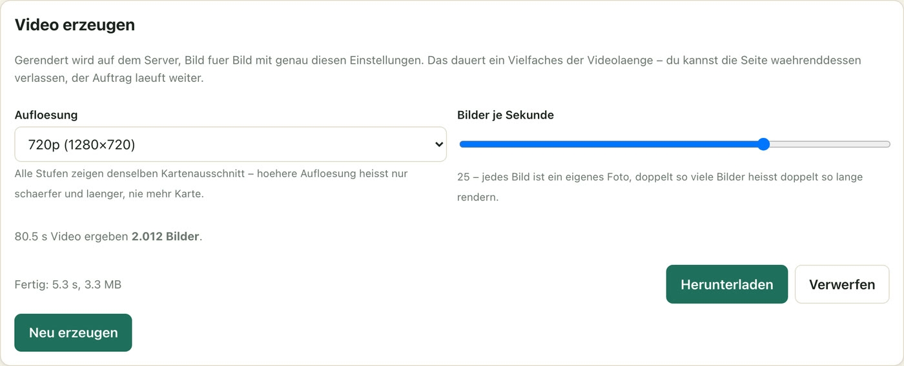
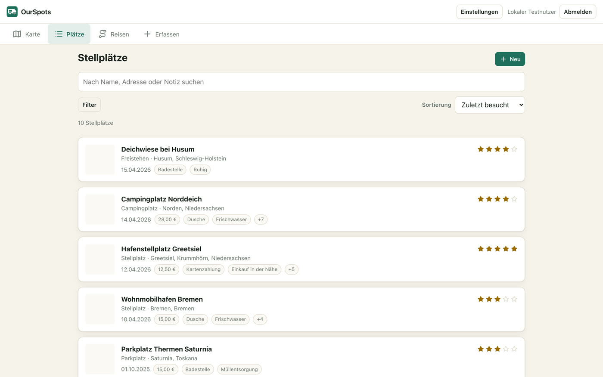

<div align="center">


# OurSpots

**Wohnmobil-Reisen planen, Stellplätze unterwegs erfassen – und am Ende ein Video daraus machen.**

Routen, die die Maße des Fahrzeugs kennen. Stellplätze mit Fotos auf der Karte.
Geteilt mit den Mitreisenden, und auch ohne Netz benutzbar.



</div>

---

Läuft selbst gehostet unter `https://spots.kirkanos.net`, Anmeldung über Authelia (OIDC).
Entstanden, weil die üblichen Apps entweder die Maße des Fahrzeugs ignorieren oder genau
dort aufhören, wo man sie braucht: ohne Netz.

| Dokument | Inhalt |
|---|---|
| [docs/KONZEPT.md](docs/KONZEPT.md) | Datenmodell, Architektur, getroffene Entscheidungen |
| [docs/DEPLOY.md](docs/DEPLOY.md) | Authelia-Client, Konfiguration, Reverse Proxy, Backup |
| [docs/ENTWICKLUNG.md](docs/ENTWICKLUNG.md) | Lokale Umgebung mit Beispieldaten, ohne Authelia |

## Reisen planen



Eine Reise bekommt Zeitraum, Status, Beschreibung und ein Fahrzeug. Zwischenziele
entstehen per Karte, Adresssuche oder GPS und lassen sich frei sortieren; einzelne
kann man festpinnen.

Die **Straßenroute rechnet OpenRouteService mit den Maßen des Wohnmobils** – also ohne
Wege unter zu niedrigen Brücken oder über Straßen, die für das Gewicht gesperrt sind.
Genau daran scheitern Autorouten in der Praxis.

- Etappen: die Reise in Tagesabschnitte zerlegen, jeder mit eigener Route
- Reihenfolge der Ziele optimieren lassen – als Vorschlag, der erst auf Bestätigung übernommen wird
- Berechnete Routen werden zwischengespeichert; unveränderte kosten kein API-Kontingent
- Export als GPX oder KML

## Stellplätze sammeln



Ein Stellplatz entsteht über die Karte oder unterwegs per „Hier bin ich" – Standort,
Name, Bewertung und Fotos in einem Zug, während man noch davorsteht.

- Art, Bewertung, Preis, Nächte, 18 Ausstattungsmerkmale und Notizen
- Einzelne Notizen als privat markierbar – die verlassen die App nie
- Fotos mit EXIF-Auswertung, serverseitig in drei WebP-Größen, ausgeliefert nur nach Zugriffsprüfung
- Karte mit Clustern, Liste mit Volltextsuche, Filtern und Umkreissuche
- Import aus GPX, KML und CSV, mit Erkennung bereits vorhandener Punkte

## Das Reisevideo

Aus der geplanten Reise entsteht eine animierte Karte: Die Route wächst mit, ein
Wohnmobil fährt sie ab, und an jeder Station taucht ein Schild mit Ortsnamen und
Kilometerstand auf.



Kartenstil (Vektor oder Satellitenbild), 3D-Gelände mit einstellbarer Überhöhung und
ausgedünnte Beschriftung – alles live in der Vorschau, ohne Renderlauf.

### Kamera und Tempo als Punkte entlang der Strecke



Ein Punkt hält Kamerahöhe, Neigung und Tempo an einer Stelle der Strecke fest.
Dazwischen blendet die Animation über – **monoton kubisch**, nicht linear: Die Kamera
wechselt ihre Geschwindigkeit stetig und schießt nie über einen gesetzten Wert hinaus.
Eine Gerade würde an jedem Punkt einen sichtbaren Knick erzeugen, ein Catmull-Rom
zwischen 8 und 10 kurzzeitig 10,4 zeigen.

Die Punkte hängen am **Streckenanteil, nicht an der Videozeit**. Wer die Sekunden je
100 km ändert, verschiebt sie damit nicht über die Landschaft.

### Gerendert wird auf dem Server



Ein eigener Container öffnet dieselbe Renderseite, die auch die Vorschau füttert, und
wird Bild für Bild weitergeschaltet – nicht in Echtzeit abgefilmt. Jedes Bild wird erst
fotografiert, wenn die Karte fertig geladen hat; ffmpeg macht daraus ein MP4.

Fotografiert wird die ganze Seite, nicht das Canvas: Wohnmobil und Schilder sind
HTML-Elemente darüber, ein Canvas-Mitschnitt hätte die Karte, aber kein Fahrzeug.

720p, 1080p und 4K zeigen **denselben Kartenausschnitt** und unterscheiden sich nur in
der Schärfe – bei einer Vektorkarte ist Auflösung eine Frage der Pixeldichte, nicht der
Fenstergröße.

> **Das dauert.** Jedes Bild ist ein eigener Screenshot: rund 4 s bei 1080p, 6,6 s bei
> 4K. Eine Minute Video braucht ein bis drei Stunden. Der Auftrag läuft im Hintergrund,
> die Seite darf man verlassen.

## Unterwegs ohne Netz



Die App ist als PWA installierbar. Offline erfasste Stellplätze und Fotos warten lokal
und gehen los, sobald wieder Verbindung besteht; die Oberfläche zeigt, wie viel noch
aussteht. Kartenausschnitte lassen sich vorab laden.

Dass das gefahrlos funktioniert, ist eine Entwurfsentscheidung: **IDs werden auf dem
Client erzeugt (UUIDv7) und alle Schreibzugriffe laufen über PUT.** Damit ist jede
Zustellung wiederholbar – die Warteschlange darf nach einem Abbruch einfach noch einmal
senden, ohne Dubletten anzulegen.

## Festhalten, auswerten, teilen

- Reisetagebuch mit Kilometerstand und Wetter
- Tankungen; Verbrauch wird aus aufeinanderfolgenden Volltankungen berechnet
- Ausgaben nach Kategorien, je Reise ausgewertet bis hinunter zu Kosten pro Tag und pro Kilometer
- Reisen für Mitreisende freigeben, mit „darf bearbeiten" oder „nur lesen"
- Öffentlicher Link für Leute ohne Konto, wahlweise mit Fotos, jederzeit widerrufbar
- Reisen ganz öffentlich schalten: Sie erscheinen dann unter `/entdecken`, ohne
  Anmeldung und ohne Notizen
- Globale Rollen: Ein Administrator vergibt Rechte, darunter die Freigabe zum
  Erzeugen von Videos. Die Vorschau darf jeder Editor.

## Aufbau

```
apps/api         NestJS + Prisma (MariaDB), OIDC, Fotos, Routing, Geocoding
apps/web         React + Vite, Leaflet, TanStack Query, Dexie, Service Worker
apps/web/src/video   Die Reiseanimation – frei von React und Kartenbibliothek
packages/shared  Zod-Schemas und Typen, von beiden Seiten genutzt
docker/          Dockerfiles, nginx-Konfiguration, Init-SQL für die Entwicklung
docker/video     Eigenständiger Renderer für Reisevideos (Chromium + ffmpeg)
```

Drei Festlegungen, die man dem Code sonst nicht ansieht:

**Die Schemas in `packages/shared` sind die einzige Quelle für die Validierung.** Das
Frontend prüft damit seine Formulare, das Backend dieselben Daten noch einmal.

**`apps/web/src/video` kennt weder React noch MapLibre-Aufrufe aus der Oberfläche.**
Vorschau und Renderer treiben dieselbe Zeichnung an – die eine mit der Uhr, der andere
Bild für Bild. Gäbe es sie zweimal, liefen Vorschau und Ergebnis früher oder später
auseinander.

**`docker/video` liegt außerhalb der npm-Workspaces.** Playwright bringt einen
kompletten Browser mit, und den soll nicht jeder `npm ci` mitinstallieren, nur um an der
Oberfläche zu arbeiten. Gebaut wird der Renderer allein aus seinem Dockerfile.

## Schnellstart

```bash
# Lokal entwickeln – ein Befehl, auch beim ersten Mal
npm run dev
```

Das richtet beim ersten Aufruf alles ein (Konfiguration, Abhängigkeiten, Datenbank im
Container, Schema, Beispieldaten) und startet API und Oberfläche. Danach
http://localhost:5173 öffnen und „Lokal anmelden (Entwicklung)" wählen – Authelia wird
dafür nicht gebraucht.

```bash
# Vollständiger Stack wie im Betrieb, lokal
docker compose -f docker-compose.local.yml up -d --build   # http://localhost:8085
```

Auf dem Server rollt Woodpecker bei jedem Push auf `main` aus – Einzelheiten in
[docs/DEPLOY.md](docs/DEPLOY.md).

| Zweck | Befehl |
|---|---|
| Alles typprüfen | `npm run typecheck` |
| Zeitachse und Kamerakurve nachrechnen | `npm run pruefe -w @ourspots/web` |
| Videorenderer lokal ausprobieren | siehe [docs/ENTWICKLUNG.md](docs/ENTWICKLUNG.md) |
| Datenbank ansehen | `npm run db:studio` |
| Lokale Datenbank neu aufbauen | `npm run dev -- --reset` |
| Stack neu bauen | `docker compose -f docker-compose.local.yml up -d --build` |
| Alles stoppen | `npm run stop` |
| Alles stoppen, auch den Stack | `npm run stop -- --all` |
| Alles inklusive Daten löschen | `npm run stop -- --purge` |
